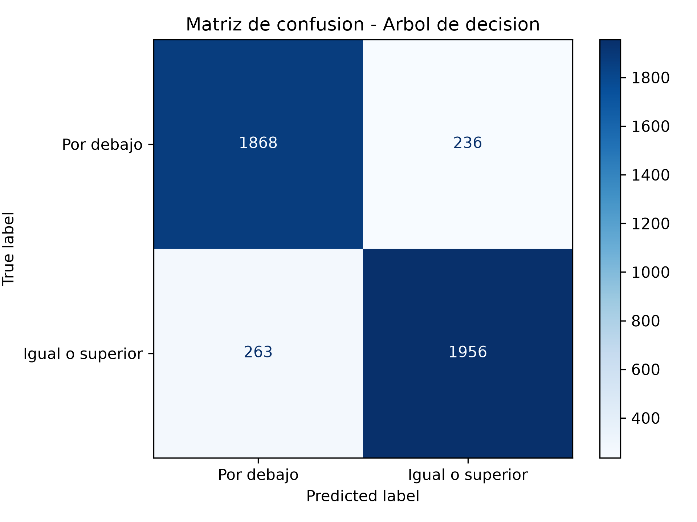
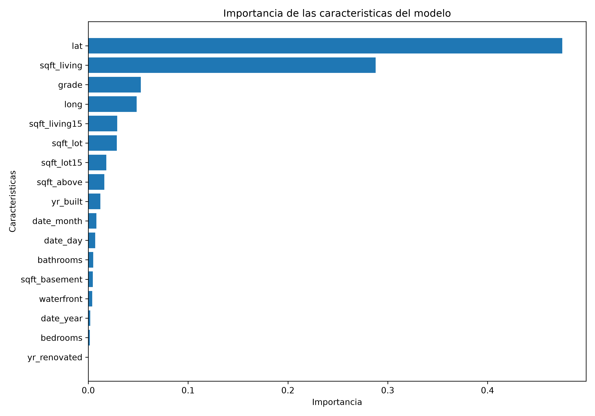

# Clasificación de viviendas mediante Machine Learning

## Integrantes

- Santiago Jimenez Otalvaro
- Santiago Ramírez Vásquez

## Descripción del proyecto

Este proyecto utiliza técnicas de Machine Learning para identificar características que permiten clasificar viviendas según su precio, tomando como referencia la mediana del conjunto de datos.

Se desarrolló un modelo de clasificación mediante un árbol de decisión, utilizando Python y la biblioteca Scikit-learn. También se implementó una ejecución automatizada mediante GitHub Actions.

## Pregunta de negocio

¿Qué características de las viviendas permiten identificar aquellas cuyo precio está por encima del precio mediano del mercado, para ayudar a compradores e inversionistas inmobiliarios a identificar posibles oportunidades de inversión?

**Beneficiarios:** compradores e inversionistas inmobiliarios.

**Decisión que apoya:** identificar viviendas que podrían requerir un análisis más detallado antes de tomar una decisión de compra o inversión.

## Dataset

- **Nombre:** House Sales (King County).
- **Fuente:** Hugging Face Datasets.
- **Repositorio:** [inria-soda/tabular-benchmark](https://huggingface.co/datasets/inria-soda/tabular-benchmark).
- **Archivo:** `reg_cat/house_sales.csv`.
- **Registros:** 21.613.
- **Columnas originales:** 18.

El conjunto de datos contiene información de viviendas de King County, Washington, Estados Unidos. Incluye características como habitaciones, baños, superficie, ubicación, año de construcción y precio.

## Preparación de los datos

Durante la revisión inicial se encontraron:

- 0 valores faltantes.
- 0 registros duplicados.
- 17 características predictoras.

Los datos se dividieron en un 80 % para entrenamiento y un 20 % para prueba.

La mediana se calculó únicamente con los precios del conjunto de entrenamiento, obteniendo un valor de `13.017005`.

Se construyó una variable objetivo con dos categorías:

- **Clase 0:** viviendas con precio por debajo de la mediana.
- **Clase 1:** viviendas con precio igual o superior a la mediana.

La columna `price` se utilizó para construir la variable objetivo y fue excluida de las características predictoras.

## Modelo de Machine Learning

Se implementó un modelo de aprendizaje supervisado mediante un árbol de decisión de clasificación (`DecisionTreeClassifier`).

Se compararon las siguientes profundidades máximas:

- 3
- 5
- 7
- 10
- Sin límite

La configuración seleccionada fue una profundidad máxima de 10, con un F1-score de validación de `0.8879`.

El modelo definitivo se entrenó utilizando todos los datos de entrenamiento y posteriormente se evaluó con el conjunto de prueba.

## Resultados

El modelo obtuvo los siguientes resultados sobre los datos de prueba:

| Métrica | Resultado |
|---|---:|
| Accuracy | 0.8846 |
| Precision | 0.8923 |
| Recall | 0.8815 |
| F1-score | 0.8869 |

La exactitud alcanzada fue del **88.46 %**.

### Características más importantes

Las cinco características con mayor importancia para el modelo fueron:

| Característica | Importancia |
|---|---:|
| lat | 47.50 % |
| sqft_living | 28.79 % |
| grade | 5.27 % |
| long | 4.85 % |
| sqft_living15 | 2.89 % |

La latitud y el área habitable fueron las características con mayor importancia en las decisiones del árbol.

### Visualizaciones

**Matriz de confusión**



**Importancia de las características**



## Hallazgos y conclusiones

Los resultados muestran que la ubicación geográfica y el tamaño del área habitable son características especialmente relevantes para identificar viviendas cuyo precio se encuentra igual o por encima de la mediana del conjunto analizado.

El modelo alcanzó un F1-score de `0.8869` en los datos de prueba, mostrando un buen equilibrio entre precisión y capacidad de identificación de la categoría positiva.

Estos resultados pueden servir como apoyo inicial para orientar la búsqueda y evaluación de posibles oportunidades inmobiliarias. Sin embargo, la importancia de las características no demuestra una relación de causa y efecto, y el modelo no calcula precios de venta ni sustituye una valoración profesional.

Para consultar el análisis completo, se puede revisar el archivo [hallazgos.md](hallazgos.md).

## Estructura del proyecto

```text
EA3_Machine_Learning/
│
├── .github/
│   └── workflows/
│       └── ejecutar_proyecto.yml
│
├── analisis_datos.py
├── requirements.txt
├── .gitignore
├── README.md
├── hallazgos.md
├── resumen.txt
├── matriz_confusion.png
└── importancia_caracteristicas.png
```

## Tecnologías utilizadas

- Python 3.11
- Pandas
- NumPy
- Scikit-learn
- Matplotlib
- Hugging Face Datasets
- Git y GitHub
- GitHub Actions

## Instalación y ejecución

Para ejecutar el proyecto localmente, se deben seguir estos pasos:

**1. Clonar el repositorio**

```bash
git clone https://github.com/Sasti240/EA3_Machine_Learning
```

**2. Ingresar a la carpeta del proyecto**

```bash
cd EA3_Machine_Learning
```

**3. Crear un entorno virtual**

```bash
python -m venv .venv
```

**4. Activar el entorno virtual**

En Windows:

```powershell
.venv\Scripts\Activate.ps1
```

**5. Instalar las dependencias**

```bash
pip install -r requirements.txt
```

**6. Ejecutar el proyecto**

```bash
python analisis_datos.py
```

Al finalizar, se generarán los siguientes archivos:

- `matriz_confusion.png`
- `importancia_caracteristicas.png`
- `resumen.txt`
- `hallazgos.md`

## Automatización con GitHub Actions

El proyecto cuenta con un flujo de trabajo automatizado mediante GitHub Actions, ubicado en `.github/workflows/ejecutar_proyecto.yml`.

La ejecución se activa cuando:

- Se realizan cambios mediante `push`.
- Se crea o actualiza un `pull_request`.
- Se solicita una ejecución manual desde GitHub Actions.

El flujo realiza automáticamente las siguientes tareas:

1. Descarga el repositorio.
2. Configura Python 3.11.
3. Instala las dependencias.
4. Ejecuta el análisis y entrenamiento del modelo.
5. Guarda los archivos generados como artefactos descargables.

Los resultados pueden consultarse desde la pestaña **Actions** del repositorio, seleccionando una ejecución y descargando el artefacto `resultados-machine-learning`.

## Estado del proyecto

**Finalizado.** El modelo fue entrenado y evaluado, los documentos y visualizaciones fueron generados y la ejecución automatizada mediante GitHub Actions fue comprobada correctamente.