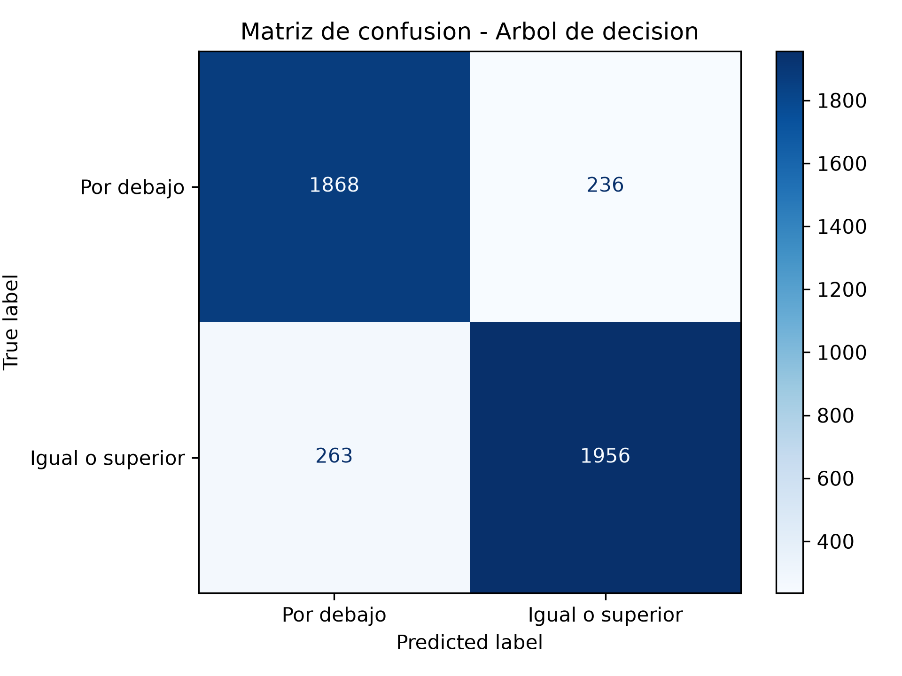
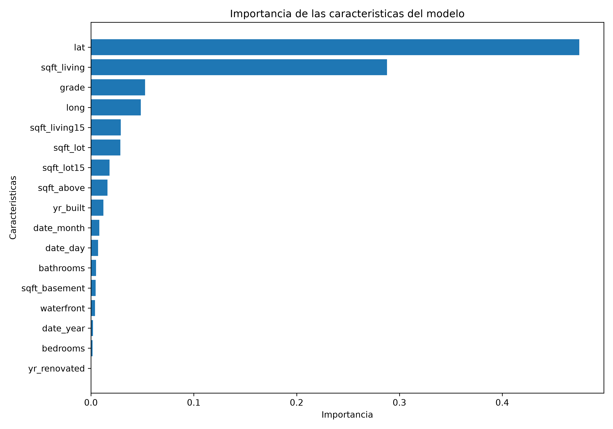

# Hallazgos del proyecto de Machine Learning

**Integrantes:** Santiago Jimenez Otalvaro y Santiago Ramírez Vásquez.

**Fecha de ejecución:** 06/11/2026

## 1. Pregunta de negocio

¿Qué características permiten identificar viviendas cuyo precio está por encima de la mediana del mercado?

El propósito es identificar características que ayuden a distinguir viviendas cuyo precio se encuentra igual o por encima de la mediana del conjunto de datos.

## 2. Dataset utilizado

Se utilizó el archivo `house_sales.csv`, disponible en el repositorio de Hugging Face `inria-soda/tabular-benchmark`.

El conjunto contiene 21613 registros y 18 columnas originales. Durante la revisión se encontraron 0 valores faltantes y 0 registros duplicados.

Se utilizaron 17 características predictoras. La columna `price` se reservó para construir la variable objetivo y no se incluyó como característica del modelo.

## 3. Preparación de los datos

La exploración inicial mostró un DataFrame de 21613 filas y 18 columnas. Se revisaron los nombres de las columnas, los tipos de datos y los primeros cinco registros.

No se encontraron valores faltantes ni registros duplicados, por lo que no fue necesario eliminar filas. Las dimensiones se conservaron después de la revisión.

Se separó la columna `price` de las 17 características predictoras. Los registros se dividieron en un 80 % para entrenamiento y un 20 % para prueba.

La mediana se calculó únicamente con los precios del conjunto de entrenamiento, cuyo valor fue **13.017005**. De esta manera, el conjunto de prueba no intervino en la definición del umbral.

Se definieron dos categorías:

- **Clase 0:** viviendas con precio por debajo de la mediana.
- **Clase 1:** viviendas con precio igual o superior a la mediana.

No se aplicó escalado ni estandarización, porque el árbol de decisión trabaja mediante condiciones de división sobre los valores de las características y no necesita que estén en una escala común.

## 4. Modelo utilizado

Se implementó un modelo de aprendizaje supervisado mediante un árbol de decisión (`DecisionTreeClassifier`).

Se compararon profundidades de 3, 5, 7, 10 y sin límite. La configuración seleccionada fue una profundidad máxima de **10**, con un F1 de validación de **0.8879**.

La selección se realizó utilizando una partición de los datos de entrenamiento. Posteriormente, el modelo definitivo se entrenó con todos los datos de entrenamiento.

## 5. Resultados de la evaluación

El modelo obtuvo los siguientes resultados sobre los datos de prueba:

| Métrica | Resultado |
|---|---:|
| Accuracy | 0.8846 |
| Precision | 0.8923 |
| Recall | 0.8815 |
| F1-score | 0.8869 |

La exactitud fue de **88.46 %**, lo que indica la proporción de clasificaciones correctas sobre las 4323 viviendas del conjunto de prueba.

### Matriz de confusión

La matriz permite observar los aciertos y errores del modelo en ambas categorías.

### Importancia de las características

Las cinco características con mayor importancia fueron:

| Característica | Importancia |
|---|---:|
| lat | 0.4750 (47.50 %) |
| sqft_living | 0.2879 (28.79 %) |
| grade | 0.0527 (5.27 %) |
| long | 0.0485 (4.85 %) |
| sqft_living15 | 0.0289 (2.89 %) |

La latitud (`lat`) y el área habitable (`sqft_living`) fueron las variables con mayor importancia en las decisiones del árbol.

## 6. Respuesta a la pregunta de negocio

Los resultados muestran que la ubicación geográfica y el tamaño del área habitable son características especialmente relevantes para identificar viviendas cuyo precio se encuentra igual o por encima de la mediana del conjunto analizado.

El modelo alcanzó un F1-score de **0.8869** en los datos de prueba, lo que refleja un equilibrio entre la precisión y la capacidad de identificar viviendas de la categoría positiva.

Esta información puede servir como apoyo inicial para compradores e inversionistas que quieran identificar viviendas que merezcan una evaluación más detallada.

### Recomendaciones prácticas

- Utilizar la ubicación geográfica y el área habitable como criterios iniciales para organizar y comparar las viviendas identificadas por el modelo.
- Revisar las características de las propiedades similares en la misma zona antes de considerar una compra o inversión.
- Comprobar el estado físico, la documentación, los costos asociados y las condiciones reales de cada inmueble antes de tomar una decisión.
- Utilizar la clasificación como un filtro inicial y no como garantía de que una vivienda representa una oportunidad rentable.

## 7. Limitaciones

- El modelo se basa en los datos disponibles y en las viviendas del conjunto analizado.
- La mediana utilizada corresponde al conjunto de entrenamiento y no representa necesariamente la mediana actual del mercado inmobiliario.
- La importancia de una característica no demuestra una relación de causa y efecto.
- El modelo clasifica viviendas en dos categorías, pero no calcula un precio de venta.
- Sus resultados no sustituyen una valoración profesional de una propiedad.

## 8. Conclusión

El árbol de decisión permitió identificar patrones relacionados con el precio de las viviendas y obtener una exactitud de 88.46 % en los datos de prueba.

La ubicación y el área habitable fueron las características más relevantes. Por tanto, el modelo ofrece una herramienta de análisis inicial que puede ayudar a orientar la búsqueda y evaluación de posibles oportunidades inmobiliarias.
